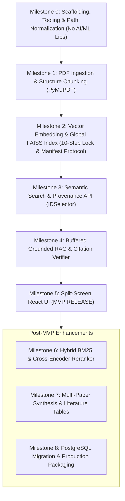

PaperMind AI — Development Roadmap & Milestones
Version: 2.3.7 (Validated Greenfield Specification)
Status: Approved for Implementation Planning
Runtime Environment: Python 3.11.x | Node.js 24 LTS
Deployment Model (MVP): Single-Worker Uvicorn Process (workers = 1)
Primary Architect: Senior Software Architect
Date: November 2026  
1. Incremental Delivery Strategy
   PaperMind AI will be built through disciplined, incremental milestones. Each milestone represents a self-contained, fully tested layer of the system. No milestone will be marked complete without passing automated unit and integration tests asserting real functional behavior.
Dependencies are staged across milestones so that initial scaffolding remains lightweight. Heavy AI/ML libraries (PyTorch, FAISS) are introduced only when their respective milestones begin.

2. Milestone Details & Behavioral Acceptance Criteria
   Milestone 0: Repository Scaffolding, Tooling & Path Normalization
   - Objective: Create the clean greenfield folder structure, establish Python 3.11 and Node.js 24 configurations, configure static analysis (Ruff, Mypy), setup frontend linting and build scripts, configure authoritative path resolution, and verify baseline test harness.
   - Dependencies Installed:
     - Backend: fastapi, uvicorn, pydantic, pydantic-settings, sqlalchemy. Dev: pytest, pytest-asyncio, httpx, ruff, mypy.
     - Frontend: React 18, React DOM, Vite, TypeScript, Tailwind CSS, ESLint.
     - Explicit Exclusion: No PyTorch, Sentence Transformers, or FAISS in M0.
   - Deliverables:
     - Root directory structure matching SYSTEM_ARCHITECTURE.md.
     - Backend: pyproject.toml with Ruff, Mypy, and Pytest configurations.
     - Backend: app/config.py with authoritative working-directory-independent path resolution for both data dir and database URL referencing module-level REPO_ROOT.
     - Frontend: package.json with working "lint" and "build" scripts.
     - Root .env.example with empty OPENAI_API_KEY= and dynamic paths.
   - Behavioral Acceptance Criteria:
     - [x] pytest backend/tests executes and reports passing status on baseline sanity test using httpx.AsyncClient.
     - [x] Path Normalization Test Suite: Test verifies identical absolute path resolution across all 5 configurations:
       1. Default configuration.
       2. Relative DATABASE_URL (e.g. sqlite:///./custom_db/test.db).
       3. Relative PAPERMIND_DATA_DIR with DATABASE_URL unset.
       4. Explicit absolute database paths.
       5. Execution from repository root and backend/ directory.
     - [x] ruff check backend passes with 0 linting errors.
     - [x] mypy backend/app passes with 0 typing errors in strict mode.
     - [x] cd frontend && npm run lint passes with 0 errors and 0 warnings.
     - [x] cd frontend && npm run build succeeds without TypeScript or bundling errors.
       Milestone 1: PDF Ingestion Engine & Structure-Aware Chunker
   - Objective: Install pymupdf and build the document parsing module to ingest academic PDFs, reconstruct complex mixed single/two-column reading orders via vertical banding, preserve normalized coordinates, detect scanned documents at the document level, and generate structured chunks.
   - Dependencies Added: pymupdf ^1.24.0.
   - Deliverables:
     - core/ingestion/parser.py: PyMuPDF layout extractor with full-width band detection and column sorting.
     - core/ingestion/exceptions.py: Structured domain exceptions (CorruptPDFException, EncryptedPDFException, ScannedPDFException, EmptyDocumentException).
     - core/ingestion/metadata.py: Title and metadata heuristic extractor.
     - core/chunking/semantic.py: Section-aware chunker producing 400-token chunks with normalized bounding-box coordinates.
     - Synthetic test fixtures: tests/fixtures/ containing minimal test PDFs (multi-column, spanning abstract, sparse page, mixed layout).
   - Behavioral Acceptance Criteria:
     - [ ] Reading Order Assertion: Test verifies that for a 2-column test fixture, left-column text is extracted completely before right-column text, with zero sentence interleaving.
     - [ ] Mixed Layout Assertion: Test verifies that full-width titles and abstracts are extracted across the full page width before two-column body text.
     - [ ] Sparse Page Tolerance: Test verifies that a valid document with a sparse page ($< 50$ characters, e.g. cover page) parses successfully without raising an exception.
     - [ ] Scanned Document Rejection: Test verifies that a simulated scanned PDF ($> 80%$ sparse pages) raises ScannedPDFException.
     - [ ] Coordinate Preservation: Every chunk asserts valid normalized bounding boxes $(x_0, y_0, x_1, y_1) \in [0, 1]$.
     - [ ] Unit tests achieve $> 85%$ line coverage across core/ingestion and core/chunking.
       Milestone 2: Vector Embedding Pipeline & Global FAISS Index (Crash-Safe Lock & Manifest)
   - Objective: Install ML dependencies, implement local embedding inference using BAAI/bge-small-en-v1.5, build the single global FAISS IndexFlatIP index with exact IDSelectorBatch filtering, persist raw embedding BLOBs in SQLite, implement the lock-before-mutation lifecycle, ACTIVE-only chunk indexing eligibility, the deterministic 10-step mutation and publication protocol, candidate-aware ingestion eligibility, exact generation membership, post-commit failure compensation, the single deterministic search-locking contract, event-loop threadpool offloading, and 6-point startup recovery validation.
   - Dependencies Added: sentence-transformers ^3.0.0, torch ^2.3.0 (CPU), faiss-cpu ^1.8.0, numpy ^1.26.0.
   - Deliverables:
     - core/embeddings/bge.py: BGE model wrapper with L2 normalization and asymmetric query prefix.
     - core/vector_store/faiss_store.py: Global FAISS IndexFlatIP manager supporting IDSelectorBatch filtering, ACTIVE-only eligibility rule, lock-before-mutation lifecycle, 10-step mutation and manifest publication protocol, post-commit compensation, thread-safe IndexSnapshot coordination, worker thread offloading, and rebuild_index_from_db().
     - db/session.py & db/models.py: SQLite schema storing chunks with embedding BLOB, library_metadata tracking index_generation, and papers table with status column (PROCESSING / ACTIVE / FAILED).
   - Behavioral Acceptance Criteria:
     - [ ] Vector Dimension & Normalization: Asserts all generated embeddings are float32 arrays with shape (384,) and $||\vec{v}||_2 = 1.0 \pm 10^{-5}$.
     - [ ] Filtering Correctness & Benchmark Suite (10,000 Chunks Scope):
       - Synthetic test fixture asserts that in a library where Paper B has higher global dot products than Paper A, querying with filter_paper_id=paper_A returns 100% Paper A chunks.
       - Executes benchmark measuring search latency over 10,000 chunks across: (1) global unfiltered search, (2) IDSelectorBatch filtered search, and (3) reference isolated single-paper search. Asserts target $< 15\text{ ms}$.
     - [ ] Candidate-Aware Eligibility Test: Use one existing ACTIVE paper, the current ingestion candidate in PROCESSING, an unrelated PROCESSING paper, and one FAILED paper. For the candidate's ingestion publication, assert that the generation contains all existing ACTIVE chunks plus all validated chunks from only the current candidate. Assert unrelated PROCESSING and FAILED chunks are excluded. For startup and deletion rebuilds, assert that only ACTIVE paper chunks are included.
     - [ ] Immediate First-Generation Search Test: Upload a new paper successfully, verify its chunks are in the published generation, then immediately search for a known passage. The result must include a chunk from that paper after the ingestion operation releases the lock.
     - [ ] Single Deterministic Search-Locking Contract Test: Asserts that every index-mutating operation (ingestion, deletion) acquires the exclusive lock before opening any SQLite transaction. Asserts that search requests acquire the exact same lock and hold it across FAISS search AND SQLite chunk hydration. Asserts there is no code path where search bypasses lock acquisition. If no valid snapshot is available after acquiring the lock, asserts search returns HTTP 503 ServiceUnavailableException.
     - [ ] FastAPI Event-Loop Non-Blocking Test: Asserts that search and ingestion requests execute their blocking vector store operations in worker threads (asyncio.to_thread), allowing concurrent non-blocking ASGI requests (e.g. /health) to respond immediately without event-loop starvation.
     - [ ] Paper Status Lifecycle & Startup Recovery Test: Assert the current ingestion candidate remains PROCESSING through Steps 1–9, is included in its own candidate generation, and becomes ACTIVE only after manifest validation and snapshot activation in Step 10. Assert startup recovery marks every interrupted PROCESSING paper FAILED, clears its faiss_id values, invalidates index_generation in the same transaction, and rebuilds from ACTIVE papers only. Assert FAILED papers are excluded from listings and search results.
     - [ ] Interruption-Point Crash & Post-Commit Compensation Test Suite:
       1. Pre-commit failure (Steps 1–7): Simulates failure before Step 8 commit; asserts SQLite rolls back or remains index_generation = NULL, paper marked FAILED, active snapshot detached.
       2. Post-commit failure with compensation (Steps 8–10): Simulates exception during manifest publication (Step 9) or verification (Step 10) after Step 8 committed index_generation = gen_uuid; asserts compensating transaction sets index_generation = NULL, clears candidate faiss_id values, sets paper status = 'FAILED', detaches the snapshot, and search returns HTTP 503.
       3. Final activation transaction failure (Step 10): Simulates failure after manifest validation and snapshot swap but before the candidate ACTIVE status transaction commits; asserts the snapshot is detached, compensation invalidates the generation, the candidate is marked FAILED where possible, and startup recovery rebuilds before searches are accepted.
       4. Post-commit crash without compensation (Process Kill): Simulates abrupt kill between Step 8 and 9; asserts startup integrity check detects mismatch (manifest.generation != sqlite.index_generation) and triggers automatic rebuild before queries are accepted.
       5. Manifest replacement atomic crash: Simulates crash during atomic os.replace; asserts startup reads either prior or new manifest and validates against SQLite.
       6. Deletion invalidation: Simulates paper deletion; asserts index_generation = NULL, snapshot detached, and startup recovers cleanly if interrupted.
     - [ ] 6-Point Startup Integrity Test: Assert startup Phase 1 atomically marks interrupted PROCESSING papers FAILED, clears their faiss_ids, and invalidates index_generation. Phase 2 asserts: (1) exact eligible chunk_id set equals mapping membership; (2) generation-member IDs are unique and contiguous 0..N-1, while nonmembers have faiss_id = NULL; (3) registry count equals $N$; (4) every mapping entry matches SQLite; (5) FAISS vector count equals $N$; (6) manifest, SQLite, mapping, and FAISS generation UUIDs match.
     - [ ] Zero-Compute Index Recovery: Deleting manifest.json and index artifacts and invoking rebuild_index_from_db() asserts that the FAISS index is reconstructed from SQLite BLOBs (ACTIVE-paper chunks only) with 100% vector fidelity in measured benchmark target $< 100\text{ ms}$ (stretch target $< 50\text{ ms}$) on CPU without recomputing embeddings.
       Milestone 3: Semantic Search & Provenance API
   - Objective: Expose FastAPI service endpoints allowing clients to upload PDFs, trigger ingestion, and execute standalone semantic search with guaranteed paper-level filtering.
   - Deliverables:
     - api/v1/endpoints/papers.py: Endpoints for uploading PDFs (POST /api/v1/papers/upload), listing papers, and deleting papers.
     - api/v1/endpoints/search.py: Semantic search endpoint (POST /api/v1/search) returning ranked chunks with paper title, page number, and snippet.
   - Behavioral Acceptance Criteria:
     - [ ] End-to-End Ingestion & Search: Uploading a sample PDF fixture followed by a search for a known passage asserts that the API returns the exact matching chunk with correct page_number and paper_id.
     - [ ] Paper Filter Enforcement: Querying the search endpoint with filter_paper_id guarantees that all returned chunks match the requested paper ID.
     - [ ] Structured Validation: Uploading an encrypted PDF returns HTTP 422 with structured error payload.
     - [ ] Benchmark Goal: Total search API latency (query encoding + FAISS search) meets measured benchmark target $< 25\text{ ms}$ for 5,000 chunks.
       Milestone 4: Buffered Grounded RAG & Citation Verification
   - Objective: Install LangChain dependencies, implement the conversational Q&A pipeline with server-side buffering, enforce citation ID verification, check claim grounding, handle abstention on unsupported queries, calibrate the abstention threshold, and deliver verified payloads via SSE.
   - Dependencies Added: langchain-core ^0.2.0, langchain-openai ^0.1.0 (or langchain-community for Ollama).
   - Deliverables:
     - core/rag/chain.py: LangChain LCEL RAG pipeline with server-side response buffering.
     - core/rag/verifier.py: Automated citation verification engine validating [^N] against context and checking lexical grounding.
     - api/v1/endpoints/rag.py: SSE streaming endpoint (POST /api/v1/query/stream) emitting verified status envelopes.
   - Behavioral Acceptance Criteria:
     - [ ] Fabricated Citation Rejection: Test fixture injecting an answer with [^99] (when only 5 chunks provided) asserts that the verifier strips the invalid citation and returns status="PARTIAL_WARNING".
     - [ ] Verified State Assertion: Fully grounded answer asserts status="VERIFIED".
     - [ ] Missing Citation Detection: Test fixture injecting factual assertions without citations asserts that the verifier flags the sentence and returns status="PARTIAL_WARNING".
     - [ ] Valid Citation Mapping: A valid citation [^1] asserts direct mapping to chunk 1's chunk_id, paper_id, and page_number.
     - [ ] Abstention Assertion: Querying an unsupported question (or where similarity $< \text{RETRIEVAL_ABSTENTION_THRESHOLD}$) asserts that the API returns: "The provided document does not contain sufficient evidence to answer this question."
     - [ ] Empirical Threshold Calibration Procedure: Run a benchmark test over 10 supported and 10 unsupported research queries; record similarity scores, measure false abstentions and false answers, and validate RETRIEVAL_ABSTENTION_THRESHOLD (default: 0.40).
       Milestone 5: Modern React Frontend & Interactive Split-Screen Reader (MVP COMPLETE)
   - Objective: Deliver the researcher web interface featuring paper upload with progress tracking, a split-screen PDF reader (react-pdf) with highlight overlays, and a verified chat assistant with clickable citation navigation.
   - Deliverables:
     - components/upload/: Drag-and-drop PDF upload with real-time status polling.
     - components/reader/: Split-screen PDF canvas viewer with synchronized page navigation and highlight bounding boxes.
     - components/chat/: Conversational interface displaying verified citations (blue badges) and warning alerts for unverified claims (amber badges).
   - Behavioral Acceptance Criteria:
     - [ ] Upload Workflow: Uploading a PDF displays real-time progress indicators (Uploading $\to$ Parsing $\to$ Embedding $\to$ Ready).
     - [ ] Interactive Citation Navigation: Clicking a citation badge [^1] in the chat immediately navigates the PDF canvas to the cited page and highlights the corresponding text section.
     - [ ] Warning Banner Display: Receiving an answer with unverified claims renders the warning banner and highlights the unverified sentence.
     - [ ] Full MVP System Test: A researcher can upload a paper, search across the library, ask a question, receive a verified answer with citations, and view the highlighted source on the PDF canvas.
       Milestone 6: Hybrid Search (BM25) & Cross-Encoder Re-ranking (Post-MVP)
   - Objective: Integrate sparse lexical search (Rank-BM25), Reciprocal Rank Fusion (RRF), and a cross-encoder re-ranking model (bge-reranker-base) for enhanced precision on technical acronyms and chemical formulas.
     Milestone 7: Multi-Paper Synthesis & Literature Tables (Post-MVP)
   - Objective: Enable cross-paper comparative analysis, automated literature review matrix generation, and BibTeX export across user-defined paper collections.
     Milestone 8: PostgreSQL Migration & Production Packaging (Post-MVP)
   - Objective: Implement Alembic database migrations, configure PostgreSQL connection pooling, create Docker Compose production configurations, and benchmark retrieval metrics on SciFact/NFCorpus.