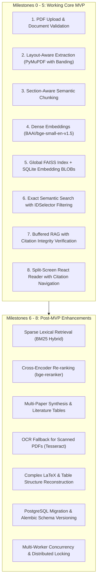

PaperMind AI — Project Brief & Product Vision
Version: 2.3.7 (Validated Greenfield Specification)
Status: Approved for Implementation Planning
Runtime Environment: Python 3.11.x | Node.js 24 LTS
Deployment Model (MVP): Single-Worker Uvicorn Process (workers = 1)
Primary Architect: Senior Software Architect
Date: November 2026  
1. Executive Summary
   PaperMind AI is an intelligent, high-precision semantic search and research-paper comprehension platform designed to accelerate scientific literature reviews and document interrogation. By uniting dense vector representations, deterministic layout-aware document extraction, in-process vector indexing, and grounded Retrieval-Augmented Generation (RAG), PaperMind AI enables researchers to interrogate academic literature with verified citation provenance and structural grounding sanity checks.
The platform is engineered as a clean, modular monolith with zero legacy code or external service dependencies, designed to run reliably on standard developer hardware as a single Uvicorn worker.
2. Core Objectives
1. Grounded Scientific Comprehension: Enable conversational question answering over academic papers where generated claims are validated against source chunks before presentation, and ungrounded assertions are flagged with explicit warning banners.
2. Deterministic Structural Extraction: Ingest academic PDFs, reconstruct complex mixed single-column and two-column reading orders via vertical banding, preserve section boundaries, and associate every chunk with immutable coordinate metadata (page number, section name, bounding box).
3. Guaranteed Paper-Level & Library Search: Deliver fast, high-recall semantic search across the entire research library or strictly within a designated paper using a single global vector index with exact IDSelector filtering.
4. Verifiable Provenance & Empirical Abstention: Guarantee that cited sources map to actual retrieved context passages, and automatically emit an explicit abstention response when documents lack sufficient evidence to answer a question (governed by a configurable similarity threshold).
5. Ergonomic Split-Screen Reader: Provide an interactive split-screen interface where clicking a verified citation instantly navigates the PDF canvas to the cited passage.
6. Realistic MVP Scope vs. Future Milestones

The 9 Mandatory MVP Capabilities
1. PDF Upload & Validation: Upload academic PDFs with validation for corruption, encryption, and document-level text density.
2. Layout-Aware Extraction: Extract paper title, abstract, sections, and page-mapped text blocks via PyMuPDF using full-width band detection and column sorting.
3. Structure-Aware Chunking: Segment text along section boundaries while maintaining maximum token limits (400 tokens) and page references.
4. Embedding Generation: Generate normalized 384-dimensional dense vectors using BAAI/bge-small-en-v1.5 on CPU.
5. Global Vector Indexing & Deterministic Publication: Store all library embeddings in a single global FAISS IndexFlatIP index published via immutable generation artifacts and an atomic manifest, backed by raw embedding BLOBs in SQLite with a deterministic 10-step lock-before-mutation publication protocol. A newly ingested paper is included in its own first candidate generation while remaining PROCESSING, then becomes ACTIVE only after successful publication and snapshot activation.
6. Exact Semantic Search with Filtering: Retrieve top-$k$ relevant passages across the library or within a specific paper using FAISS IDSelectorBatch to restrict result eligibility to the target paper.
7. Passage Highlighting: Expose normalized bounding-box coordinates to locate source passages on the rendered PDF canvas.
8. Buffered RAG & Citation Verification: Buffer LLM responses, validate citation IDs [^N] against retrieved context chunks, flag ungrounded assertions, and communicate verification states (VERIFIED, PARTIAL_WARNING, ABSTENTION).
9. Interactive Split-Screen Reader: View PDF on canvas, read verified answers, and navigate directly to cited passages on click.
10. Problem Statement & Target Audience
    The Problem
    - Information Overload: Researchers face tens of thousands of domain papers, making exhaustive literature review unsustainable.
    - Lexical Limitations: Keyword search engines miss conceptually identical work using differing scientific terminology.
    - Generic Chat PDF Pitfalls: Naive sliding-window splitters destroy reading flow, confuse two-column layouts, hallucinate citations, and lack provenance tracking.
      Target Audience
    - Academic Researchers & Postdocs: Streamlining literature reviews and prior art verification.
    - Graduate & Undergraduate Students: Fast onboarding into complex, unfamiliar scientific domains.
    - R&D Engineers & Industry Scientists: Interrogating technical reports, whitepapers, and patent literature.
11. Non-Functional Requirements & Measured Benchmark Targets
    Specified Evaluation Environment
    - Hardware: Standard 8-core CPU (x86_64 Intel/AMD or Apple Silicon), 16 GB RAM, no GPU required (pure CPU execution).
    - Operating Systems: Windows 11, macOS 13+, Ubuntu 22.04 LTS.
    - Runtimes & Process Model: Python 3.11.x, Node.js 24 LTS, Single Uvicorn Worker (workers = 1).
      Measured Benchmark Targets (Evaluation Environment)
      Metric	Benchmark Target	Stretch Benchmark Target	Verification Methodology
      PDF Ingestion Throughput	$< 5.0\text{ s}$ for 15-page PDF	$< 3.5\text{ s}$	Measured wall-clock time from upload to vectors stored in FAISS (CPU execution)
      FAISS Search Latency	$< 15\text{ ms}$ for 10,000 chunks	$< 8\text{ ms}$	Query vector inner product search over 10,000 chunks (IndexFlatIP)
      Index Recovery Time	$< 100\text{ ms}$ for 10,000 chunks	$< 50\text{ ms}$	Rebuilding FAISS index from stored SQLite BLOBs without embedding recomputation
      Response Turnaround	$< 4.0\text{ s}$ total query-to-verification	$< 2.5\text{ s}$	Total duration including retrieval, buffered LLM generation, and citation verification
      Memory Footprint	$< 1.5\text{ GB}$ RSS	$< 1.0\text{ GB}$	Peak RAM consumption of the FastAPI backend process during embedding generation
      Citation ID Integrity	$100%$ valid	$100%$ valid	Zero fabricated citation indices ([^N] where $N > k$) permitted in verified responses
      Configurable Abstention	Empirically calibrated	Empirically calibrated	Abstention triggers when retrieval similarity $< \text{threshold}$ (initial default: 0.40)
[!NOTE]
All performance metrics are measured benchmark targets under the specified hardware environment, not theoretical guarantees. The $< 15\text{ ms}$ search target is formally specified for the MVP scope of 10,000 chunks; performance at larger scales (e.g. 50,000 chunks) requires separate empirical benchmarking.