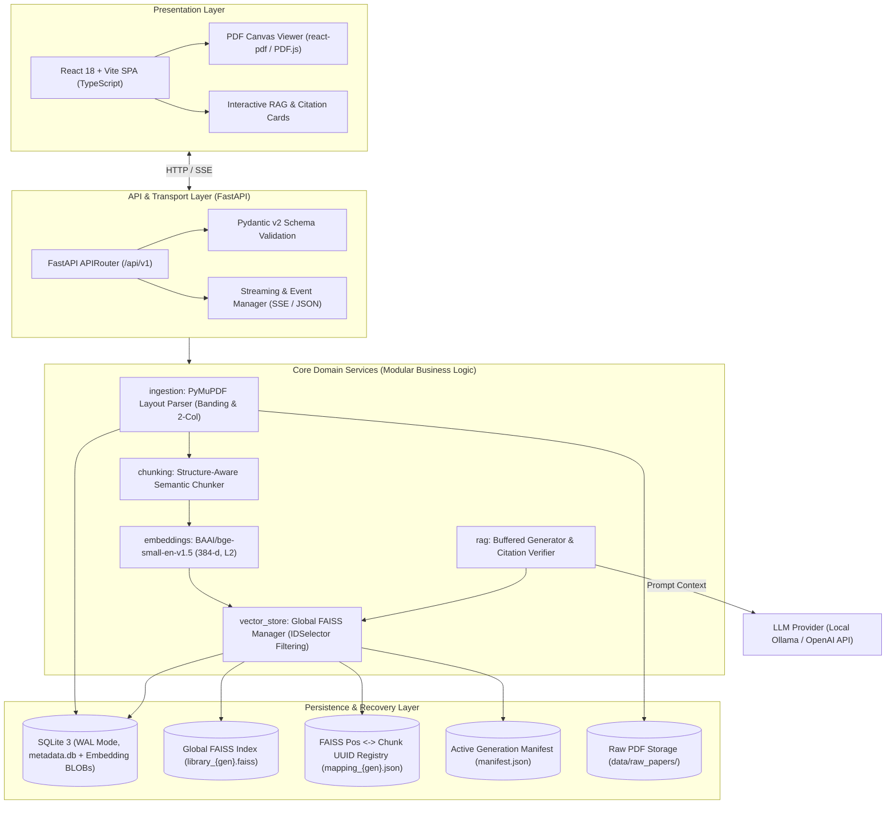
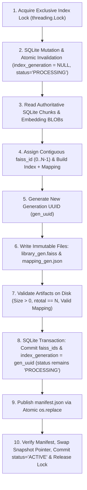
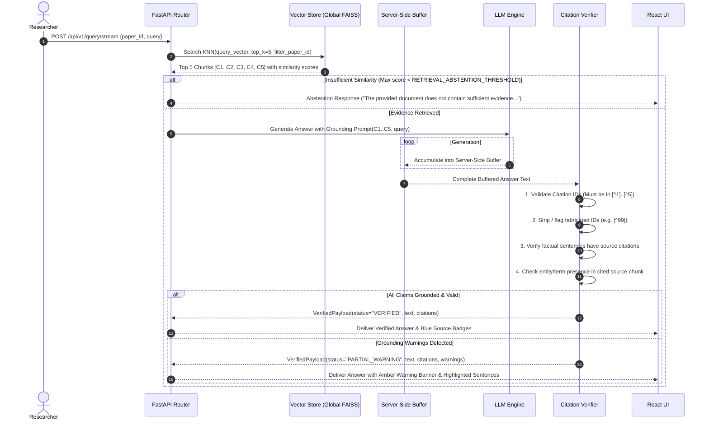

PaperMind AI — System Architecture Document
Version: 2.3.7 (Validated Greenfield Specification)
Status: Approved for Implementation Planning
Runtime Environment: Python 3.11.x | Node.js 20 LTS
Deployment Model (MVP): Single-Worker Uvicorn Process (workers = 1)
Primary Architect: Senior Software Architect
Date: November 2026  
1. Architectural Paradigm: Modular Monolith
   PaperMind AI is structured as a Modular Monolith adhering to Clean Architecture principles. Business logic, data ingestion, vector operations, and LLM orchestration are strictly decoupled from delivery mechanisms (FastAPI REST endpoints and React UI).

2. Core Subsystems & Responsibilities
   2.1 Ingestion & PDF Extraction Subsystem (core.ingestion)
   - Technology: PyMuPDF (fitz).
   - Layout Logic (Mixed Single-Column & Two-Column Support):
     1. Block Extraction: Extracts text blocks using page.get_text("blocks"), yielding bounding boxes $(x_0, y_0, x_1, y_1)$ and text contents.
     2. Full-Width Spanning Block Detection:
        - A block is classified as full-width/spanning if its width $(x_1 - x_0) > 0.70 \times \text{page_width}$, or if it spans across the page centerline ($x_0 < 0.40 \times W$ and $x_1 > 0.60 \times W$).
        - Spanning blocks include Titles, Author blocks, Abstracts, full-width section headers, and full-width tables or figures.
     3. Vertical Banding & Column Sorting:
        - Spanning blocks divide the page vertically into sequential bands.
        - For bands containing two-column text between spanning blocks:
          - Blocks with $x_1 \le 0.55 \times W$ are assigned to the Left Column.
          - Blocks with $x_0 \ge 0.45 \times W$ are assigned to the Right Column.
          - The reading order is strictly reconstructed: Left Column sorted top-to-bottom ($y_0$), followed by Right Column sorted top-to-bottom ($y_0$).
     4. Coordinate Normalization:
        - Every block retains normalized coordinates $(x_0/W, y_0/H, x_1/W, y_1/H) \in [0, 1]$ alongside raw PDF points to enable precise canvas overlays regardless of zoom level.
   - Document-Level Scanned Document Detection:
     - Detection occurs at the document level, not per-page.
     - A PDF is classified as scanned if $> 80%$ of its pages have $< 50$ extracted text characters, OR if total document text density is $< 100$ characters per page.
     - Sparse individual pages (e.g., cover pages, full-page diagrams, or appendix illustrations) do not fail an otherwise valid paper.
   - Structured Failure Reporting:
     - The extraction pipeline raises domain-specific exceptions mapped to HTTP status codes:
       - CorruptPDFException $\to$ HTTP 400: "PDF file is corrupted and cannot be opened."
       - EncryptedPDFException $\to$ HTTP 422: "Encrypted/password-protected PDFs are not supported."
       - ScannedPDFException $\to$ HTTP 422: "Scanned PDF without text layer detected. OCR is scheduled for a future milestone."
       - EmptyDocumentException $\to$ HTTP 400: "PDF contains zero readable pages."
   - Explicit MVP Element Limitations:
     - Tables: Extracted as contiguous text blocks within section boundaries; complex multi-row grid reconstruction is deferred.
     - Figures: Raster image pixels are ignored; figure captions are extracted as text blocks.
     - Math: Preserved as extracted Unicode text; LaTeX OCR formula reconstruction is deferred.
       2.2 Structure-Aware Chunking Subsystem (core.chunking)
   - Strategy: Section-aware semantic chunking.
   - Mechanism:
     - Detects major section headings using regex and formatting markers (Abstract, 1. Introduction, 2. Methodology, 3. Experiments, 4. Conclusion, References).
     - Target chunk size: 400 tokens (~1,600 characters) with a 50-token overlap.
     - Chunk boundaries never cross primary section boundaries.
     - Every chunk retains:{
       "chunk_id": "c_uuid4_string",       # Permanent, immutable chunk identity
       "paper_id": "p_uuid4_string",       # Permanent parent paper identity
       "section_title": "3. Methodology",
       "page_number": 4,
       "bbox": [0.12, 0.34, 0.48, 0.65],  # normalized [x0, y0, x1, y1]
       "char_start": 1240,
       "char_end": 2840,
       "text": "..."
       
       }
       2.3 Embedding Subsystem (core.embeddings)
   - Exact Model: BAAI/bge-small-en-v1.5 via Hugging Face sentence-transformers.
   - Dimensionality: $d = 384$.
   - Normalization: Strict L2 normalization ($||\vec{v}||_2 = 1.0$) applied to all generated vectors.
   - Asymmetric Search Configuration:
     - Queries are encoded with the official BGE instruction prefix:
       "Represent this sentence for searching relevant passages: "
     - Document chunks are encoded directly without prefix.
   - Execution Target: PyTorch running on CPU by default with automatic batching ($B = 32$).
     2.4 Vector Storage & Single Global Index Subsystem (core.vector_store)
     2.4.1 Global Index & FAISS IDSelectorBatch Complexity Reality
   - Index Architecture: One global FAISS IndexFlatIP (Exact Inner Product on L2-normalized vectors).
   - Filtering Mechanism:
     - Uses faiss.SearchParameters(sel=faiss.IDSelectorBatch(target_faiss_ids)) where target_faiss_ids is retrieved from SQLite.
   - Computational Complexity & Filtering Reality:
     - IDSelectorBatch restricts result eligibility; it guarantees filtering correctness by ensuring that only chunks belonging to the specified paper can enter the top-$k$ result heap.
     - Computational Complexity: IndexFlatIP does not partition memory or skip vector rows during traversal. It executes an exhaustive scan of all $N$ library vectors, with time complexity $O(N \cdot d)$ plus an $O(1)$ selector hash/bitmap membership check per candidate.
     - MVP Scope & Benchmark Reality: For the evaluated MVP scope of $10{,}000$ chunks, $O(N \cdot d)$ inner product math executes within the measured benchmark target ($< 15\text{ ms}$) on the specified 8-core CPU hardware. Performance at larger scales (e.g. 50,000 chunks) requires separate empirical benchmarking.
     - Benchmark Suite: Milestone 2 implements an empirical benchmark comparing:
       1. Global unfiltered search across $N$ chunks.
       2. IDSelectorBatch filtered search over the target paper.
       3. Isolated reference search over a dedicated index containing only the target paper.
          2.4.2 Explicit ID Semantics & Index-Changing Mutations
          To prevent pointer drift, dangling references, and index corruption:
   - Separation of ID Identities:
     - chunk_id (UUID4 string): The permanent, immutable identity of a chunk across SQLite, citations, and user interfaces.
     - faiss_id (integer): A generation-specific vector position (0, 1, ..., N-1) within the active FAISS index, not a permanent identity.
     - The mapping registry is always deterministically regenerated from persistent chunk UUIDs.
   - Full Generation Rebuild & Contiguous ID Assignment (Authoritative MVP Policy):
     - Every index-changing operation (paper ingestion, paper deletion, or recovery rebuild) constructs a complete new FAISS generation from the full eligible chunk set. The MVP does not append vectors to the currently published FAISS index.
     - For each new generation, assign faiss_id values contiguously from 0 through N-1 in the deterministic order used to build that generation (paper_id, then chunk_index).
     - faiss_id values are generation-specific positions and may be reassigned or reused in a later generation. They must never be treated as permanent identifiers; chunk_id remains the permanent identity.
     - The exact mapping registry chunk_id set defines generation membership. Step 8 clears faiss_id for every nonmember and assigns the new contiguous positions only to generation members.
   - Lock-Before-Mutation Mandate for All Index-Changing Operations:
     - To eliminate any race window where search requests could observe a database state that no longer corresponds to the active in-memory FAISS index, the process-wide exclusive index lock (threading.Lock) must be acquired BEFORE starting any SQLite transaction that modifies the indexed chunk set.
     - The exclusive lock remains continuously held throughout database mutation, generation invalidation, index rebuild, SQLite generation commit, manifest publication, disk validation, active in-memory snapshot replacement, and any required post-commit failure compensation.
     - Paper Deletion Lifecycle (Within Exclusive Lock):
       1. Acquire process-wide exclusive index lock (threading.Lock).
       2. In a single SQLite transaction, delete paper and chunk records AND immediately invalidate the active index generation:BEGIN TRANSACTION;
          DELETE FROM chunks WHERE paper_id = :paper_id;
          DELETE FROM papers WHERE id = :paper_id;
          UPDATE library_metadata SET index_generation = NULL WHERE key = 'index_generation';
          COMMIT;
       3. In-memory active snapshot is immediately detached (self._snapshot = None), preventing any concurrent or subsequent read from using the old index.
       4. Execute the deterministic rebuild and publication sequence (reconstruct index and mapping from remaining SQLite chunks, write immutable generation artifacts, commit new contiguous faiss_ids and generation UUID to SQLite, atomically replace manifest.json, swap active in-memory snapshot pointer).
       5. Only release the exclusive lock after verification of the published manifest.
       6. If a crash or handled failure occurs, the post-commit compensation and crash recovery protocol ensures index_generation = NULL, triggering mandatory auto-rebuild on startup before queries are accepted.
     - Paper Ingestion Lifecycle & Status Policy (Within Exclusive Lock):
       1. Parse the PDF, produce the complete chunk set, generate embeddings, and validate vector count, dimensions, dtype, finite values, and normalization before entering the index mutation critical section. This CPU work does not mutate the indexed SQLite chunk set and must not hold the global index lock.
       2. Acquire the process-wide exclusive index lock (threading.Lock) before opening any database mutation transaction.
       3. In one SQLite transaction, insert the paper with status = 'PROCESSING', insert its complete chunk metadata and embedding BLOBs, and set library_metadata.index_generation = NULL. Commit, then detach the in-memory snapshot (self._snapshot = None).
       4. Define this paper's ID as the operation's candidate_paper_id. It remains PROCESSING and is not visible in ordinary paper listings while its candidate generation is built.
       5. Build the candidate generation from all existing ACTIVE paper chunks plus the complete chunks belonging to this one candidate_paper_id. This is the sole allowed PROCESSING exception. Exclude every unrelated PROCESSING paper and every FAILED paper.
       6. Publish and validate the generation. Only after the manifest has been re-read and validated and the in-memory snapshot has been activated may a SQLite transaction change the candidate paper to ACTIVE.
       7. Keep the exclusive lock held until the status transaction commits successfully. If that transaction fails, detach the snapshot, run compensation, and keep search unavailable until recovery.
       8. Deterministic Paper Status Recovery:
          - User-facing paper listings filter to status = 'ACTIVE'.
          - Candidate chunks are searchable immediately after the ingestion operation releases the lock because they are present in the newly activated generation mapping.
          - If ingestion fails, the candidate is marked FAILED, its faiss_id values are cleared, and the generation is invalidated through compensation.
          - At startup, every leftover PROCESSING paper is marked FAILED and the generation is invalidated before rebuilding from ACTIVE papers only.
2.4.3 Deterministic 10-Step Mutation & Publication Protocol & Post-Commit Compensation
Independent replacement of library.faiss and library_mapping.json is not atomic. PaperMind AI implements an immutable, generation-based manifest publication protocol coupled with pre-mutation locking and explicit post-commit compensation:

Complete 10-Step Mutation & Publication Sequence:
1. Acquire Exclusive Index Lock: Acquire the process-wide exclusive lock (threading.Lock) before opening any database transaction. All mutations are serialized; no search request can observe intermediate states.
2. Execute SQLite Mutation & Atomic Invalidation: In one single SQLite transaction:
   - Apply row changes (insert chunk records with raw embedding BLOBs and paper status = 'PROCESSING', or delete paper and associated chunk rows).
   - Atomically invalidate generation: UPDATE library_metadata SET index_generation = NULL WHERE key = 'index_generation';.
   - Commit this transaction.
   - Detach active in-memory snapshot: self._snapshot = None.
3. Read Eligible SQLite Chunk Records:
   - For ingestion, select chunks from existing ACTIVE papers plus the complete chunk set for the single validated :candidate_paper_id:SELECT c.id, c.paper_id, c.embedding
     FROM chunks c
     JOIN papers p ON c.paper_id = p.id
     WHERE p.status = 'ACTIVE'
     OR (p.id = :candidate_paper_id AND p.status = 'PROCESSING')
     ORDER BY c.paper_id, c.chunk_index
   - The caller must verify that candidate_paper_id belongs to this exact locked ingestion operation and that its full chunk/embedding set passed validation.
   - For deletion and startup recovery, select ACTIVE papers only. Every unrelated PROCESSING paper and every FAILED paper is excluded.
4. Assign Contiguous Generation-Specific faiss_ids & Build Structures: Reassign contiguous generation-specific faiss_id values 0..N-1, decode embedding BLOBs into an $(N, 384)$ float32 NumPy array, construct the new IndexFlatIP, add vectors, and construct the mapping registry mapping faiss_id $\leftrightarrow$ chunk_id.
5. Generate New Generation UUID: Generate gen_uuid = uuid4().hex.
6. Write Immutable Artifacts: Write immutable generation-specific artifacts: data/vector_indices/library_{gen_uuid}.faiss and data/vector_indices/mapping_{gen_uuid}.json.
7. Validate Artifacts Before Publication: Validate both artifacts on disk: check files exist, file sizes $> 0$, faiss.read_index loads cleanly, index.ntotal == N, and mapping JSON parses with exactly $N$ entries.
8. Commit SQLite Transaction (Atomic Generation Update): In one SQLite transaction:
   - Set faiss_id = NULL for every chunk not present in the candidate generation mapping.
   - Persist contiguous faiss_id assignments 0..N-1 for the exact candidate-generation members only.
   - Update library_metadata.index_generation = gen_uuid and total_chunks = N.
   - Keep the ingestion candidate's paper status as PROCESSING until Step 10.
   - Commit this transaction.
9. Publish Manifest via Atomic Replacement:
   - Write data/vector_indices/manifest.json.tmp containing:{
     "generation": "gen_uuid",
     "faiss_file": "library_gen_uuid.faiss",
     "mapping_file": "mapping_gen_uuid.json",
     "chunk_count": 1420,
     "published_at": "2026-11-23T01:00:00Z"
     }
   - Atomically publish via a single os.replace("data/vector_indices/manifest.json.tmp", "data/vector_indices/manifest.json").
10. Validate Published Generation, Swap Snapshot Pointer, Activate Paper & Release Lock:
    - Re-read manifest.json, verify that manifest.generation == gen_uuid.
    - Atomically swap the active in-memory snapshot pointer: self._snapshot = IndexSnapshot(faiss_index, mapping, reverse_mapping, gen_uuid, N).
    - For paper ingestion: execute a fast SQLite transaction updating paper status = 'ACTIVE':UPDATE papers SET status = 'ACTIVE' WHERE id = :paper_id;
    - Release the exclusive lock to accept incoming search queries.
      Explicit Failure Handling & Post-Commit Compensation:
      The failure handling behavior distinguishes between failures occurring before versus after Step 8:
    - Failure Before Step 8 Commits (Steps 1–7):
      - Any handled failure rolls back any active SQLite transaction.
      - The SQLite database remains at index_generation = NULL (committed in Step 2).
      - If ingestion: a compensating transaction sets paper status = 'FAILED'.
      - Active snapshot remains unavailable (self._snapshot = None).
      - The exclusive lock is released in a finally block.
      - Subsequent searches acquire the lock, see self._snapshot is None, and return HTTP 503.
    - Failure After Step 8 Commits but Before Step 10 Completes (Steps 8–10):
      - In Step 8, SQLite committed index_generation = gen_uuid_new. Therefore, SQLite does not automatically remain at NULL.
      - If an exception occurs during manifest publication (Step 9) or manifest validation/snapshot activation (Step 10), the exception handler must execute a compensating SQLite transaction:BEGIN TRANSACTION;
        UPDATE library_metadata SET index_generation = NULL WHERE key = 'index_generation';
        UPDATE papers SET status = 'FAILED' WHERE id = :paper_id; -- if ingestion
        COMMIT;
      - The exclusive lock remains held throughout this compensation.
      - The active snapshot remains unavailable (self._snapshot = None).
      - Compensation Failure Boundary: If the compensating SQLite transaction itself fails (e.g. SQLite database disk I/O error):
        - Log the critical error immediately.
        - Keep self._snapshot = None.
        - Release the lock safely in a finally block to prevent process deadlock.
        - Subsequent searches return HTTP 503 because self._snapshot is None.
        - Startup integrity recovery is required to re-synchronize the database and index before search queries can be accepted.
    - Process Crash (Unhandled Interruption / Power Loss / SIGKILL):
      - An abrupt process crash cannot execute software compensation.
      - On restart, the 6-point startup integrity check detects that manifest.generation != sqlite.index_generation (or index_generation = NULL), refuses to serve search queries, and triggers rebuild_index_from_db() from live SQLite chunk records before accepting search traffic.
    - Core Invariant: The application will never serve search requests using a mismatched, invalidated, uncompensated, or unverified generation.
      Strengthened 6-Point Startup Integrity Validation & Recovery:
      On startup, before accepting any search traffic, the system executes the following sequence:
Phase 1 — Interrupted Ingestion Recovery (Before Index Validation):
- In one SQLite transaction, detect whether any paper remains PROCESSING from an interrupted operation.
- If one or more exist, set those papers to FAILED, set their chunk faiss_id values to NULL, and set library_metadata.index_generation = NULL in that same transaction.
- Retain paper and chunk records for auditability. No interrupted candidate is eligible during startup recovery.
- This invalidation is mandatory even if the manifest appears to match the SQLite generation: a crash may have occurred after manifest publication or snapshot activation but before the paper's ACTIVE status transaction.
- If recovery changed any paper status, rebuild and republish from ACTIVE papers only before accepting searches.
  Phase 2 — 6-Point Index Integrity Check:
1. Exact Generation Membership: Build the expected eligible persistent chunk_id set from SQLite (ACTIVE papers only during startup). Assert that this set equals the exact chunk_id set in the generation mapping registry. Do not infer membership from numeric faiss_id range alone.
2. Contiguous IDs: Generation-member SQLite rows have unique, non-NULL faiss_id values exactly covering 0..N-1; all chunks outside the generation have faiss_id = NULL.
3. Registry Count: The mapping registry contains exactly $N$ entries.
4. Exact Mapping Consistency: Every mapping entry resolves to the same persistent chunk_id, paper_id, and faiss_id in SQLite, with no unexpected chunk present.
5. Vector Count Integrity: The FAISS index contains exactly $N$ vectors (index.ntotal == N).
6. Unified Generation Match: The manifest, SQLite metadata, mapping registry, and FAISS artifact filename identify the same non-NULL generation UUID.
   - If any check fails, or Phase 1 changed any paper status, rebuild_index_from_db() executes automatically from ACTIVE-paper chunks before queries are accepted.
     2.4.4 Deterministic Search-Locking Contract & FastAPI Synchronization Safety
     One Deterministic Search-Locking Contract:
     To eliminate ambiguous concurrency states between FAISS results and relational chunk hydration, the architecture enforces one single, deterministic contract for all search requests:
     def search_sync(query_vector: np.ndarray, top_k: int, filter_paper_id: str | None = None) -> list[ChunkResult]:
     with index_lock:  # 1. Acquire process-wide exclusive lock
     snapshot = self._snapshot  # 2. Acquire active snapshot reference
     if snapshot is None or self._index_generation is None:
     # 3. If no valid snapshot is available, fail cleanly
     raise ServiceUnavailableException("Search index is currently unavailable and requires rebuild")
     
     # 4. Execute FAISS search under lock
     scores, faiss_ids = self._raw_search(snapshot.index, query_vector, top_k, filter_paper_id)
     
     # 5. Mapping resolution under lock
     chunk_ids = [snapshot.mapping[fid] for fid in faiss_ids if fid in snapshot.mapping]
     
     # 6. SQLite chunk hydration under lock
     chunks = self._hydrate_chunks_from_db(chunk_ids)
     
     return format_results(chunks, scores)
7. Lock Scope: Every search request acquires the same process-wide index synchronization lock (threading.Lock).
8. Lock Hold Duration: The search request holds the lock for the entire operation: snapshot acquisition, FAISS search, mapping resolution, and SQLite chunk hydration.
9. Writer Coordination: Writers acquire that exact same lock before any SQLite mutation and retain it through publication, snapshot replacement, and any compensation.
10. Execution Invariant: A search executes only against a fully published, validated generation.
11. Clean 503 Rejection: If no valid snapshot is available after acquiring the lock (i.e. self._snapshot is None or library_metadata.index_generation is NULL), the search immediately raises an HTTP 503 ServiceUnavailableException.
12. Zero Stale Hydration: Because the search holds the lock through SQLite chunk hydration, a search can never capture an old snapshot and hydrate metadata after a writer has changed SQLite.
    FastAPI Synchronization Safety (Non-Blocking Event Loop):
    In FastAPI, endpoint handlers defined with async def run directly on the single-threaded asyncio event loop of the Uvicorn worker process.
    [!CAUTION]
    Event Loop Blocking Prohibition: Directly calling threading.Lock.acquire() or executing CPU-bound FAISS inner product searches on the event loop is strictly prohibited. It would block the event loop, freezing all concurrent ASGI connections (such as health probes, active SSE streams, and incoming uploads).
    - Implementation-Safe Worker Thread Offloading:
      - The complete blocking vector-store operation (lock acquisition, snapshot validation, FAISS CPU vector math, mapping lookup, SQLite chunk hydration, and lock release) is offloaded to a worker thread via await asyncio.to_thread(...):@router.post("/api/v1/search", response_model=SearchResponse)
        async def search_endpoint(request: SearchRequest, vector_store: VectorStore = Depends(get_vector_store)):
        # Offload entire blocking locked routine to worker thread pool
        results = await asyncio.to_thread(
        vector_store.search_sync,
        query_vector=request.query_vector,
        top_k=request.top_k,
        filter_paper_id=request.filter_paper_id
        )
        return SearchResponse(results=results)
      - Alternatively, endpoint handlers may be declared as standard synchronous def functions, which FastAPI and Starlette automatically run in AnyIO's external worker thread pool.
      - Writers (paper ingestion, paper deletion, index rebuild) similarly offload their complete blocking workflow to a worker thread via asyncio.to_thread(...).
      - This ensures that:
        1. The asyncio event loop remains completely unblocked and responsive to all concurrent non-blocking I/O.
        2. The single Uvicorn worker process (workers = 1) provides rock-solid thread safety via threading.Lock.
           2.4.5 Single-Worker Concurrency Model (MVP)
    - Deployment Scope: The MVP deployment model runs strictly as a single Uvicorn worker process (workers = 1).
    - Process-Local Locking: An exclusive process-wide threading.Lock serializes all write operations (ingestion, deletion, rebuild) and synchronizes search requests via thread pool worker execution.
    - Authoritative Recovery: The 6-point startup integrity validation (Phase 1 paper-eligibility recovery + Phase 2 index integrity check) is the authoritative MVP recovery mechanism. Administrative rebuild API endpoints are not required for MVP delivery.
    - Multi-Worker Boundaries: Process-local locking is sufficient strictly for this single-worker model. Multi-worker deployments or cross-process safety require distributed locking (e.g. file lock or Redis), which is deferred to post-MVP production milestones.
      2.5 Buffered Grounded RAG & Verification Semantics (core.rag)
      To prevent ungrounded, fabricated, or misattributed citations from reaching the client, response generation is buffered server-side before client delivery.

2.5.1 Exact Verification Semantics & States
The system implements three formal verification states:
State	Semantic Definition	UI Communication
VERIFIED	All citation anchors [^N] map to valid retrieved chunk indices ($1 \le N \le k$), every factual sentence includes a citation, and all cited sentences passed lexical/entity overlap sanity checks against the source chunk text.	Rendered with interactive blue citation badges ([^1]). Tooltips display source text snippet and page number.
PARTIAL_WARNING	All citation IDs are structurally valid, but one or more cited sentences failed the lexical/entity overlap sanity check (or a factual sentence lacked a citation anchor).	Rendered with an amber warning banner: ⚠️ Warning: Some statements in this response could not be verified against the cited source text. Affected sentences are highlighted with warning indicators.
ABSTENTION	The maximum retrieval similarity is below the configurable RETRIEVAL_ABSTENTION_THRESHOLD (initial default: 0.40), or the LLM indicated that the document lacks evidence.	Rendered as a clean informational notice: "The provided document does not contain sufficient evidence to answer this question." No citations are emitted.

[!CAUTION]
Heuristic Boundary Notice: Lexical and entity overlap is an automated heuristic sanity check designed to catch hallucinations and misattributions. It does NOT constitute formal proof of semantic truth or scientific correctness.

2.6 Working-Directory-Independent Configuration (app.config)
To eliminate working-directory discrepancies across CLI commands, tests, and servers, path resolution is anchored strictly to the repository root via Path(file). Module-level REPO_ROOT is referenced directly in property resolvers, ensuring valid Pydantic Settings:
from pathlib import Path
from pydantic_settings import BaseSettings
Absolute repository root: <repo_root>/backend/app/config.py -> parent.parent.parent
REPO_ROOT: Path = Path(file).resolve().parent.parent.parent

class Settings(BaseSettings):
PAPERMIND_ENV: str = "development"
PAPERMIND_DATA_DIR: Path = Path("./data")
DATABASE_URL: str | None = None
EMBEDDING_MODEL_ID: str = "BAAI/bge-small-en-v1.5"
EMBEDDING_DEVICE: str = "cpu"
RETRIEVAL_ABSTENTION_THRESHOLD: float = 0.40  # Initial configurable threshold
LLM_PROVIDER: str = "openai"
OPENAI_API_KEY: str = ""
CORS_ORIGINS: str = "http://localhost:5173"
@property
def resolved_data_dir(self) -> Path:
    """Ensures data directory is always absolute, resolving relative paths against module-level REPO_ROOT."""
    if self.PAPERMIND_DATA_DIR.is_absolute():
        return self.PAPERMIND_DATA_DIR
    return (REPO_ROOT / self.PAPERMIND_DATA_DIR).resolve()

@property
def resolved_database_url(self) -> str:
    """Guarantees absolute, working-directory-independent database URL."""
    if self.DATABASE_URL:
        if self.DATABASE_URL.startswith("sqlite:///") and not self.DATABASE_URL.startswith("sqlite:////"):
            rel_path = self.DATABASE_URL.replace("sqlite:///", "")
            return f"sqlite:///{(REPO_ROOT / rel_path).resolve().as_posix()}"
        return self.DATABASE_URL
    # Default: Anchored in resolved_data_dir
    return f"sqlite:///{(self.resolved_data_dir / 'metadata.db').resolve().as_posix()}"

3. Project Directory Structure
   Papermind_antigravity/
   ├── docs/                               # Architectural & Technical Specifications
   │   ├── PROJECT_BRIEF.md
   │   ├── SYSTEM_ARCHITECTURE.md
   │   ├── TECH_STACK.md
   │   ├── DEVELOPMENT_ROADMAP.md
   │   ├── DECISION_LOG.md
   │   ├── MILESTONE_0_CHECKLIST.md
   │   ├── PROJECT_SETUP_GUIDE.md
   │   └── CHANGELOG.md
   ├── backend/                            # Python 3.11 Backend
   │   ├── pyproject.toml                  # Dependencies & tooling (Ruff, Mypy, Pytest)
   │   ├── app/
   │   │   ├── init.py
   │   │   ├── main.py                     # FastAPI application factory & lifespan
   │   │   ├── config.py                   # Authoritative dynamic path resolution
   │   │   ├── api/
   │   │   │   ├── init.py
   │   │   │   ├── deps.py                 # Dependency injection
   │   │   │   └── v1/
   │   │   │       ├── init.py
   │   │   │       ├── router.py           # Aggregated v1 router
   │   │   │       └── endpoints/
   │   │   │           ├── papers.py       # Upload, list, delete papers
   │   │   │           ├── search.py       # Semantic vector search (IDSelector)
   │   │   │           └── rag.py          # Grounded Q&A & streaming
   │   │   ├── core/
   │   │   │   ├── init.py
   │   │   │   ├── ingestion/              # PyMuPDF extraction, banding, 2-column
   │   │   │   │   ├── init.py
   │   │   │   │   ├── parser.py
   │   │   │   │   ├── exceptions.py       # Structured ingestion errors
   │   │   │   │   └── metadata.py
   │   │   │   ├── chunking/               # Structure-aware chunking
   │   │   │   │   ├── init.py
   │   │   │   │   └── semantic.py
   │   │   │   ├── embeddings/             # BGE-small-en-v1.5 wrapper
   │   │   │   │   ├── init.py
   │   │   │   │   └── bge.py
   │   │   │   ├── vector_store/           # Global FAISS IndexFlatIP + Manifest Publication
   │   │   │   │   ├── init.py
   │   │   │   │   └── faiss_store.py
   │   │   │   └── rag/                    # Buffered RAG & citation verifier
   │   │   │       ├── init.py
   │   │   │       ├── chain.py
   │   │   │       └── verifier.py
   │   │   ├── db/                         # SQLite Persistence (Metadata + BLOBs)
   │   │   │   ├── init.py
   │   │   │   ├── session.py              # SQLAlchemy 2.0 engine & sessionmaker
   │   │   │   └── models.py               # ORM models (Paper, Chunk, Metadata)
   │   │   └── schemas/                    # Pydantic v2 schemas
   │   │       ├── init.py
   │   │       ├── paper.py
   │   │       ├── search.py
   │   │       └── rag.py
   │   └── tests/                          # Automated Test Suite
   │       ├── init.py
│       ├── conftest.py                 # Pytest fixtures & HTTPX TestClient
│       ├── unit/                       # Unit tests (synthetic fixtures)
│       ├── integration/                # API endpoint integration tests
│       └── fixtures/                   # Minimal synthetic PDF fixtures
├── frontend/                           # React 18 + Vite Frontend
│   ├── package.json                    # Dependencies & lint script
│   ├── tsconfig.json
│   ├── vite.config.ts                  # Vite config with API proxy
│   ├── tailwind.config.js
│   ├── index.html
│   └── src/
│       ├── main.tsx
│       ├── App.tsx
│       ├── components/
│       │   ├── layout/                 # Header, Sidebar, Container
│       │   ├── reader/                 # PDF Canvas Viewer with highlights
│       │   ├── chat/                   # RAG Chat & Citation Cards
│       │   └── upload/                 # Drag-and-drop PDF upload modal
│       ├── hooks/
│       │   ├── useSSE.ts               # Streaming SSE consumer hook
│       │   └── usePapers.ts            # Paper query & state management
│       ├── services/
│       │   └── api.ts                  # Fetch API client
│       └── types/
│           ├── paper.ts
│           └── rag.ts
├── data/                               # Persistent Storage (Git-ignored)
│   ├── raw_papers/                     # Stored PDF binaries
│   ├── vector_indices/                 # manifest.json + generation artifacts
│   └── metadata.db                     # SQLite database file
├── .env.example                        # Root environment variable blueprint
├── .gitignore
└── README.md