PaperMind AI — Technology Stack & Staged Dependency Matrix
Version: 2.3.7 (Validated Greenfield Specification)
Status: Approved for Implementation Planning
Runtime Environment: Python 3.11.x | Node.js 20 LTS
Deployment Model (MVP): Single-Worker Uvicorn Process (workers = 1)
Primary Architect: Senior Software Architect
Date: November 2026  
1. Staged Dependency Lifecycle
   To keep early development lightweight, dependencies are staged strictly across milestones. Heavy AI/ML libraries (PyTorch, Sentence Transformers, FAISS) are NOT installed in Milestone 0.

```mermaid
flowchart LR
    subgraph M0_Deps ["Milestone 0: Core Foundation"]
        FastAPI["fastapi ^0.111.0"]
        Pydantic["pydantic ^2.7.0"]
        PydSettings["pydantic-settings ^2.2.0"]
        SQLAlchemy["sqlalchemy ^2.0.0"]
        HTTPX["httpx ^0.27.0 (dev)"]
        Pytest["pytest ^8.2.0 (dev)"]
        Ruff["ruff ^0.4.0 (dev)"]
        Mypy["mypy ^1.10.0 (dev)"]
        React["React 18 + Vite (Frontend)"]
        Tailwind["Tailwind CSS + ESLint"]
    end

    subgraph M1_Deps ["Milestone 1: PDF Extraction"]
        PyMuPDF["pymupdf ^1.24.0"]
    end

    subgraph M2_Deps ["Milestone 2: Embeddings & Vector Index"]
        ST["sentence-transformers ^3.0.0"]
        Torch["torch ^2.3.0 (CPU)"]
        FAISS["faiss-cpu ^1.8.0"]
        NumPy["numpy ^1.26.0"]
    end

    subgraph M4_Deps ["Milestone 4: RAG Orchestration"]
        LC["langchain-core ^0.2.0"]
        LCOpenAI["langchain-openai ^0.1.0"]
    end

    M0_Deps --> M1_Deps --> M2_Deps --> M4_Deps
```

2. In-Depth Component Analysis & Trade-Off Matrix
   2.1 Backend Core: Python 3.11+, FastAPI & Pydantic Settings
   - Language: Python 3.11.x. Optimal C-extension support for PyMuPDF, PyTorch, and FAISS.
   - Framework: FastAPI (^0.111.0). Provides native ASGI concurrency for handling long-lived HTTP and SSE streaming connections.
   - FastAPI Synchronization Safety & Event Loop Protection:
     - Endpoint handlers defined with async def execute on the single asyncio event loop. Directly invoking blocking threading.Lock.acquire(), FAISS CPU matrix calculations, or SQLite queries on the event loop blocks all concurrent connections.
     - All blocking vector store operations (lock acquisition, FAISS search, SQLite chunk hydration, lock release) and write workflows are offloaded to worker threads via await asyncio.to_thread(...) (or standard synchronous def endpoints executed via AnyIO's threadpool).
     - Keeps the event loop responsive for concurrent non-blocking ASGI requests while guaranteeing process-local thread safety.
   - Authoritative Configuration Management: pydantic-settings.BaseSettings with dynamic root path resolution:
     - Repository root is anchored to module-level REPO_ROOT = Path(file).resolve().parent.parent.parent.
     - Both relative data directory overrides (PAPERMIND_DATA_DIR) and relative SQLite database paths (DATABASE_URL) are dynamically resolved against module-level REPO_ROOT, guaranteeing identical file resolution regardless of process working directory.
   - Test Infrastructure: httpx included as a core dev dependency alongside pytest and pytest-asyncio to power FastAPI's TestClient.
     2.2 Relational Storage & Embedding BLOB Persistence
   - Selected for MVP: SQLite 3 running with Write-Ahead Logging (PRAGMA journal_mode=WAL;).
   - Embedding BLOB Storage:
     - Raw 384-dimensional float32 vectors are stored directly in SQLite chunks.embedding as binary BLOB data (1,536 bytes/chunk).
     - Total storage cost for 10,000 chunks is only $\approx 15.36\text{ MB}$.
     - Enables instantaneous zero-compute index recovery with a measured benchmark target of $< 100\text{ ms}$ (stretch target $< 50\text{ ms}$) without re-running expensive embedding models.
   - Library Metadata Table: Stored key-value metadata table records model identifier, embedding dimension, normalization rule, index_generation UUID, and schema version.
   - PostgreSQL Migration Reality:
     - Migrating to PostgreSQL for multi-tenant production requires:
       1. Schema versioning and migration scripts via Alembic.
       2. Dialect validation (PostgreSQL native UUID, JSONB, and BYTEA data types).
       3. Connection pooling configuration (QueuePool).
       4. Foreign key index optimization for concurrent multi-user write transactions.
          2.3 Single Global FAISS Vector Index, ID Semantics & Manifest Publication
   - Index Type: IndexFlatIP (Exact Inner Product on L2-normalized 384-dimensional vectors).
   - Explicit ID Semantics:
     - chunk_id (UUID4 string) is the permanent, immutable identity of a chunk across SQLite, citations, and user interfaces.
     - faiss_id (integer) is a generation-specific vector position in FAISS, not a permanent identity. Every MVP index-changing operation builds a complete new eligible generation and reassigns contiguous positions 0..N-1; append-in-place is not used. Positions may be reused in later generations.
     - Mapping registries are always deterministically regenerated from persistent chunk UUIDs.
   - Full-generation rebuild policy: Ingestion, deletion, and startup recovery each build a complete new FAISS generation from the eligible SQLite chunk set. The mapping registry's exact persistent chunk_id set defines membership; nonmembers receive faiss_id = NULL, and members receive contiguous generation-specific IDs 0..N-1 in deterministic (paper_id, chunk_index) order.
   - Exact Paper-Level Filtering via IDSelectorBatch:
     - Restricts result eligibility strictly to the target paper's vector IDs.
     - Computational Complexity: In IndexFlatIP, the selector does not skip rows; FAISS performs an exhaustive scan across all $N$ library chunks with $O(N \cdot d)$ complexity plus an $O(1)$ selector hash/bitmap lookup per candidate.
     - MVP Viability & Benchmark Scope: For the evaluated MVP scope of $10{,}000$ chunks, $O(N \cdot d)$ inner product math satisfies our measured search latency target ($< 15\text{ ms}$) on multi-core CPUs. Performance at larger scales (e.g. 50,000 chunks) requires separate empirical benchmarking.
   - Lock-Before-Mutation Lifecycle, Paper Status Handling & Indexing Eligibility:
     - The process-wide exclusive lock (threading.Lock) must be acquired before starting any SQLite transaction that mutates the indexed chunk set (ingestion, deletion, rebuild).
     - The lock remains held continuously throughout database mutation, atomic generation invalidation (index_generation = NULL), index rebuild, SQLite generation commit, manifest publication, disk validation, active in-memory snapshot replacement, and any required post-commit compensation.
     - Ingestion inserts a paper as status = 'PROCESSING'. It remains absent from ordinary paper listings until Step 10.
     - Candidate-aware indexing eligibility: For the current ingestion operation only, Step 3 includes all existing ACTIVE paper chunks plus the complete, validated chunk set for that operation's explicit candidate_paper_id. This is the sole permitted PROCESSING candidate. Unrelated PROCESSING papers and all FAILED papers are excluded. Startup recovery and deletion rebuilds include ACTIVE papers only.
     - Exact generation membership is defined by the persistent chunk_id set in the mapping registry, not by whether a stale numeric faiss_id happens to fall inside 0..N-1. At Step 8, chunks outside the generation receive faiss_id = NULL; generation members receive contiguous 0..N-1 positions.
   - Deterministic 10-Step Mutation & Publication Protocol:
     - Step 3 selects existing ACTIVE chunks plus only the validated current ingestion candidate (or ACTIVE chunks only for deletion/startup rebuild).
     - Step 8 atomically clears nonmember faiss_id values, assigns contiguous positions to exact generation members, and commits index_generation = gen_uuid while the ingestion candidate remains PROCESSING.
     - Step 9 publishes manifest.json via atomic os.replace.
     - Step 10 validates the manifest, swaps the active IndexSnapshot, commits the candidate paper status = 'ACTIVE', and releases the lock only after the status transaction succeeds.
   - One Deterministic Search-Locking Contract:
     - Every search request acquires the same process-wide threading.Lock used by writers and holds it for the entire operation: snapshot acquisition, FAISS search, mapping resolution, and SQLite chunk hydration.
     - Writers acquire that exact same lock before any SQLite mutation and hold it through publication, snapshot replacement, and any required compensation.
     - A search executes only against a fully published, validated generation.
     - If no valid snapshot is available after acquiring the lock (i.e. self._snapshot is None), the search immediately returns HTTP 503 ServiceUnavailableException.
     - Because the lock is held across the entire operation, a search can never capture an old snapshot and hydrate metadata after a writer has changed SQLite.
     - All blocking vector-store operations (lock acquisition, FAISS search, SQLite hydration) execute in worker threads via asyncio.to_thread(...), keeping the asyncio event loop unblocked.
   - Post-Commit Failure Compensation:
     - Failures before Step 8 leave SQLite index_generation = NULL and set paper status = 'FAILED'.
     - Failures after Step 8 commits execute a compensating transaction setting index_generation = NULL and paper status = 'FAILED'. Lock remains held; snapshot remains None.
     - If compensation itself fails: log critically, keep snapshot None, release lock safely in finally, and require startup integrity recovery.
     - Unhandled process crash: startup integrity check detects generation mismatch and rebuilds before queries are accepted.
   - Startup Recovery & 6-Point Startup Validation:
     - Phase 1: If interrupted PROCESSING papers remain, one SQLite transaction marks them FAILED, clears their chunk faiss_id values, and invalidates library_metadata.index_generation = NULL. Retain records for auditability; rebuild from ACTIVE papers only before accepting searches.
     - Phase 2 — 6-point check: (1) exact eligible chunk_id set equals mapping membership; (2) generation-member IDs are unique and contiguous 0..N-1, while nonmembers have faiss_id = NULL; (3) registry has $N$ entries; (4) every mapping entry matches SQLite; (5) FAISS contains $N$ vectors; (6) manifest, SQLite, registry, and FAISS generation UUIDs match.
     - Startup integrity validation is the authoritative MVP recovery mechanism. Administrative rebuild API endpoints are not required for MVP delivery.
   - Concurrency Serialization:
     - MVP runs strictly as a single Uvicorn worker process (workers = 1). Operations run in worker threads off the event loop. Multi-worker distributed locking is deferred to post-MVP production.
       2.4 Embedding Engine: BAAI/bge-small-en-v1.5
   - Identifier: BAAI/bge-small-en-v1.5 (via sentence-transformers).
   - Dimensionality: $d = 384$.
   - Model Footprint: $\approx 133\text{ MB}$ (cached in ~/.cache/huggingface/hub/).
   - Inference Speed: Measured target of ~12ms per 400-token chunk on an 8-core CPU; encodes a 15-page paper in $< 1.0\text{ s}$.
   - Normalization: L2 normalization ($||\vec{v}||_2 = 1.0$) applied immediately to all generated vectors.
   - Asymmetric Search: Queries use the prefix "Represent this sentence for searching relevant passages: ". Document chunks are encoded without prefix.
     2.5 PDF Extraction: PyMuPDF (fitz) Layout Analysis
   - Technology: PyMuPDF (fitz).
   - Multi-Column & Mixed Layout Strategy:
     - Detects full-width spanning blocks: $(x_1 - x_0) > 0.70 \times W$ or spanning the centerline ($x_0 < 0.40 \times W$ and $x_1 > 0.60 \times W$).
     - Spanning blocks divide the page vertically into bands. Two-column text between spanning blocks is partitioned by $x$-midpoint and sorted: Left Column top-to-bottom ($y_0$), then Right Column top-to-bottom ($y_0$).
     - Page coordinates are preserved as normalized bounding boxes $(x_0/W, y_0/H, x_1/W, y_1/H) \in [0, 1]$.
   - Document-Level Scanned Detection:
     - PDFs are classified as scanned only if $> 80%$ of pages have $< 50$ text characters or average character density $< 100$ chars/page. Individual sparse pages (diagrams, cover pages) do not trigger rejection.
   - Structured Exceptions: Domain-specific exceptions (CorruptPDFException, EncryptedPDFException, ScannedPDFException, EmptyDocumentException) with clear HTTP status codes.
     2.6 Grounded RAG & Buffered Citation Verification
   - Framework: LangChain Core / LCEL.
   - Execution Flow:
     1. Retrieve top-$k$ context chunks from global FAISS store using IDSelectorBatch.
     2. If maximum similarity score $< \text{RETRIEVAL_ABSTENTION_THRESHOLD}$ (initial default: 0.40), return standardized abstention payload.
     3. LLM generates complete response into a server-side buffer.
     4. Citation Verifier executes on buffered text:
        - Validates all [^N] citation IDs against retrieved chunk indices ($1 \le N \le k$). Fabricated IDs (e.g. [^99]) are stripped and flagged.
        - Confirms factual statements cite source chunks.
        - Runs lexical/entity check against cited source chunk (acknowledging this is a heuristic sanity check and does not prove semantic correctness or eliminate hallucinations).
     5. Verified payload delivered to client with verification status envelope (VERIFIED, PARTIAL_WARNING, ABSTENTION).
        2.7 Frontend Presentation: React 18, Vite, TypeScript & Tailwind CSS
   - Framework: React 18+ with TypeScript using Vite for sub-second HMR.
   - Linting: Pre-configured ESLint script in package.json ("lint": "eslint . --ext ts,tsx --report-unused-disable-directives --max-warnings 0").
   - PDF Viewer: react-pdf / pdfjs-dist rendering HTML5 Canvas with normalized coordinate highlight overlays.
   - Communication: Native fetch with ReadableStream consuming SSE streaming endpoints.